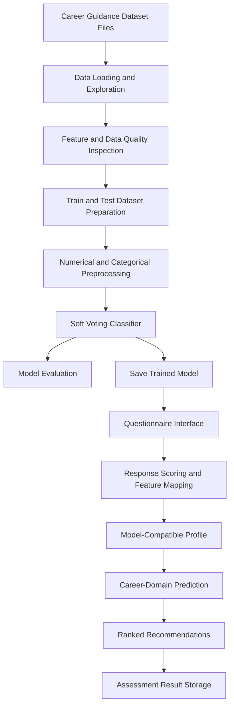
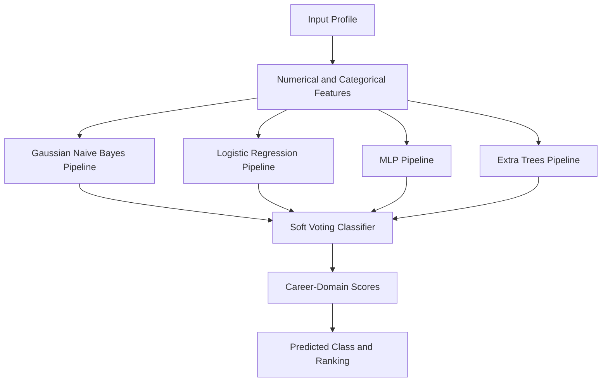

# An Adaptive Machine Learning Framework for Mapping Dynamic Skillsets to Lifelong Trajectories

An adaptive machine learning framework for analysing individual interests, aptitude, personality traits, skills, and educational background to generate career-domain recommendations. The project uses a structured feature dataset, a preprocessing pipeline, and an ensemble classification model to map a learner profile to relevant career domains.

The implementation combines exploratory data analysis, feature preparation, supervised machine learning, model evaluation, and a questionnaire-based application interface. The objective is to provide a structured, data-driven starting point for career exploration and lifelong learning decisions.

**Core value:** Transform structured learner-profile information into ranked career-domain recommendations through a reproducible machine learning workflow.

---

## Table of Contents

- [1. Project Overview](#1-project-overview)
- [2. Problem Statement and Motivation](#2-problem-statement-and-motivation)
- [3. Objectives](#3-objectives)
- [4. Key Features](#4-key-features)
- [5. System and Workflow Overview](#5-system-and-workflow-overview)
- [6. Repository Structure](#6-repository-structure)
- [7. Dataset Overview](#7-dataset-overview)
- [8. Data Preprocessing and Integration Pipeline](#8-data-preprocessing-and-integration-pipeline)
- [9. Feature Engineering](#9-feature-engineering)
- [10. Machine Learning Methodology](#10-machine-learning-methodology)
- [11. Model Selection and Justification](#11-model-selection-and-justification)
- [12. Mathematical Formulation](#12-mathematical-formulation)
- [13. Results and Evaluation](#13-results-and-evaluation)
- [14. Visualizations and Outputs](#14-visualizations-and-outputs)
- [15. How to Run the Project](#15-how-to-run-the-project)
- [16. Technologies Used](#16-technologies-used)
- [17. Limitations and Future Improvements](#17-limitations-and-future-improvements)
- [18. Ethical and Responsible Use](#18-ethical-and-responsible-use)
- [19. Contributors and License](#19-contributors-and-license)

---

## 1. Project Overview

Career planning involves understanding how an individual's interests, abilities, personality, skills, and educational background relate to different professional domains. These characteristics are diverse and may be represented through different question types and data formats.

This project implements an **AI-powered career guidance platform** using machine learning to classify a learner profile into career domains. The core model is a soft-voting ensemble classifier, supported by preprocessing pipelines for numerical and categorical data.

The project also includes a questionnaire-based interface that collects learner responses, calculates selected feature scores, and presents the highest-ranked career recommendations.

### Core Idea

The system follows this general workflow:

1. Load the available datasets and inspect their structure.
2. Prepare the feature dataset and examine its quality.
3. Separate model input features from the target variable.
4. Apply numerical and categorical preprocessing.
5. Train and evaluate a supervised classification model.
6. Load the saved model for inference.
7. Collect questionnaire responses and map supported answers to model features.
8. Generate ranked career-domain recommendations.

The framework currently operates on structured profile features. It does not establish a complete longitudinal model of how skills evolve over time; temporal trajectory prediction remains a potential extension.

---

## 2. Problem Statement and Motivation

Career recommendations often require the consideration of multiple factors rather than a single academic score or isolated skill. Interests, aptitude, personality, skills, education, and professional experience can all contribute to the suitability of a career domain.

These factors introduce several technical challenges:

- **Heterogeneous inputs:** Learner profiles contain both numerical ratings and categorical attributes.
- **Feature consistency:** The training and inference stages must use the same feature names, order, and expected data types.
- **Missing information:** A user may not provide every feature required by the model.
- **Career-domain classification:** Multiple career domains must be distinguished from the combined learner profile.
- **Interpretation:** Ranked model outputs need to be presented as guidance rather than definitive career decisions.
- **Long-term adaptability:** A learner's preferences, qualifications, and skills can change, so a practical system should allow assessments to be updated over time.

The project addresses the structured profile-classification problem through a supervised machine learning workflow. A unified feature representation allows the model to process numerical and categorical attributes together.

### Technical Questions

1. Can structured learner-profile features be used to classify career domains?
2. How can numerical and categorical inputs be processed consistently?
3. How can multiple classification algorithms be combined into an ensemble?
4. How well does the saved model classify previously held-out records?
5. How can questionnaire responses be converted into the features expected by the trained model?

---

## 3. Objectives

1. Load and inspect the available career-guidance datasets.
2. Examine feature distributions, data types, and dataset structure.
3. Prepare numerical and categorical features for machine learning.
4. Construct a supervised classification workflow using a defined target variable.
5. Train an ensemble model using multiple classification algorithms.
6. Evaluate classification performance on a held-out test dataset.
7. Save and reload the trained model for subsequent inference.
8. Develop a questionnaire-driven interface for collecting learner information.
9. Convert supported responses into model-compatible feature values.
10. Present ranked career-domain recommendations with model scores.
11. Identify limitations in feature mapping, assessment scoring, and generalization.

---

## 4. Key Features

- **Exploratory data analysis:** Inspect dataset dimensions, columns, distributions, and summary statistics.
- **Structured learner representation:** Represent interests, aptitude, personality, skills, education, age group, experience stage, and residential area.
- **Numerical preprocessing:** Impute missing numerical values and standardize numerical features.
- **Categorical preprocessing:** Impute missing categorical values and apply one-hot encoding.
- **Ensemble classification:** Combine four classification pipelines through soft voting.
- **Model persistence:** Save and reload the trained model using Joblib.
- **Career-domain prediction:** Generate predictions for 12 career domains.
- **Ranked recommendations:** Use the model's class scores to display the highest-ranked domains.
- **Questionnaire interface:** Collect responses using rating scales, agreement scales, skills scales, multiple-choice questions, and dropdowns.
- **Assessment storage:** Store submitted questionnaire responses, calculated features, and recommendations in a local CSV file.
- **Feature inspection:** Display the feature scores generated from mapped questionnaire answers.

The questionnaire interface is an integration layer around the trained model. Its scoring rules and feature mappings require validation before the results can be interpreted as formal psychometric measurements.

---

## 5. System and Workflow Overview

### End-to-End Architecture



### Workflow Stages

| Stage | Purpose | Input | Output |
|---|---|---|---|
| Dataset loading | Read the available structured data | CSV files | DataFrames |
| Exploration | Inspect structure, features, and distributions | Loaded datasets | Data understanding |
| Feature preparation | Separate predictors and target | Training and test datasets | Feature matrices and target labels |
| Preprocessing | Handle missing values and transform inputs | Numerical and categorical features | Model-ready features |
| Model training | Fit the ensemble classifier | Training feature matrix and target | Trained classifier |
| Evaluation | Assess classification performance | Held-out test data | Classification metrics |
| Model persistence | Save the fitted classifier | Trained model | Joblib model artifact |
| Questionnaire processing | Collect and map supported answers | User responses | Feature-score representation |
| Inference | Predict career domains | Model-compatible profile | Ranked career domains |
| Result storage | Retain assessment outputs | Responses and predictions | Local CSV records |

### Data Integration Diagram

The repository contains raw, processed, training, and test dataset files. The available implementation establishes a processed feature dataset and separate training and test datasets. A multi-source join or merge workflow with documented join keys has not been established from the available implementation details.


---

## 6. Repository Structure

The following structure reflects the files identified during project development. The exact placement of the application, model artifact, and questionnaire should be verified against the repository before publication.

```text

AnAdaptiveMachineLearningFrameworkForMappingDynamicSkillsetsToLifelongTrajectories/

├── 01_Career_Guidance_EDA.ipynb

├── career_guidance_raw_synthetic.csv

├── career_guidance_processed.csv

├── career_guidance_train.csv

├── career_guidance_test.csv

├── data_dictionary.json

├── dataset_summary.csv

├── README.md

├── AI_Career_Guidance_Questions.xlsx

├── app.py

├── artifacts/

│   └── career_guidance_model.joblib

└── assessment_results.csv          # Created after an assessment is submitted

```

> The `assessment_results.csv` file is generated at runtime. The application and model artifact paths should be checked against the actual GitHub repository before committing this README.

### Important Files

| File or Folder | Purpose |
|---|---|
| `01_Career_Guidance_EDA.ipynb` | Notebook for exploratory data analysis and dataset inspection. |
| `career_guidance_raw_synthetic.csv` | Available raw dataset file. |
| `career_guidance_processed.csv` | Processed feature dataset used during development. |
| `career_guidance_train.csv` | Training dataset containing model features and the target variable. |
| `career_guidance_test.csv` | Held-out test dataset used for evaluation. |
| `data_dictionary.json` | Dataset field and feature documentation. |
| `dataset_summary.csv` | Summary information about the dataset. |
| `AI_Career_Guidance_Questions.xlsx` | Questionnaire containing 123 original questions and their associated metadata. |
| `app.py` | Streamlit questionnaire and recommendation interface developed during the project. |
| `artifacts/career_guidance_model.joblib` | Saved fitted classification model. |
| `assessment_results.csv` | Local assessment output file created by the application after a successful submission. |

---

## 7. Dataset Overview

The project uses structured records containing demographic, educational, interest, aptitude, personality, and skill-related features. The classification target is `recommended_career_domain`.

### Dataset Files

| Filename | Identified dimensions | Purpose | Role in the workflow |
|---|---:|---|---|
| `career_guidance_raw_synthetic.csv` | [Add exact dimensions] | Raw dataset file | Initial data source |
| `career_guidance_processed.csv` | 2,400 × 27 | Processed profile data | Feature dataset |
| `career_guidance_train.csv` | 1,920 × 26 | Training records | Model fitting |
| `career_guidance_test.csv` | 480 × 26 | Test records | Held-out evaluation |
| `dataset_summary.csv` | [Add exact dimensions] | Dataset summary | Dataset documentation |
| `data_dictionary.json` | JSON document | Feature definitions | Data interpretation |
| `AI_Career_Guidance_Questions.xlsx` | 123 × 8 | Questionnaire and scoring metadata | User-input specification |

The processed dataset includes a `profile_id` field in addition to the feature and target columns. The training and test files contain 25 model input features and one target column.

### Target Variable

`recommended_career_domain`

The model predicts one of the following 12 classes:

1. Business \& Management
2. Creative Arts \& Media
3. Cybersecurity
4. Data Science \& Analytics
5. Digital Marketing
6. Education \& Research
7. Engineering \& Core Technology
8. Finance \& Accounting
9. Healthcare \& Life Sciences
10. Law \& Public Service
11. Software Development
12. UI/UX Design

### Model Input Features

The model expects 25 input features, grouped as follows.

| Feature group | Columns |
|---|---|
| Profile and demographics | `age_group`, `education_level`, `experience_stage`, `region_type` |
| Interests | `interest_technology`, `interest_data`, `interest_problem_solving`, `interest_creativity`, `interest_people`, `interest_helping` |
| Aptitude | `aptitude_logical`, `aptitude_numerical`, `aptitude_verbal`, `aptitude_spatial`, `aptitude_critical_thinking` |
| Personality | `trait_openness`, `trait_conscientiousness`, `trait_extraversion`, `trait_agreeableness`, `trait_emotional_stability` |
| Skills | `skill_programming`, `skill_data_analysis`, `skill_research`, `skill_communication`, `skill_leadership` |

### Data Dictionary

| Column | Type | Description |
|---|---|---|
| `profile_id` | Identifier | Profile identifier present in the processed dataset. |
| `age_group` | Categorical | Learner age-group category. |
| `education_level` | Categorical | Educational qualification category. |
| `experience_stage` | Categorical | Current education or work-experience stage. |
| `region_type` | Categorical | Residential-area category. |
| `interest_technology` | Numerical | Reported interest in technology. |
| `interest_data` | Numerical | Reported interest in data and analysis. |
| `interest_problem_solving` | Numerical | Reported interest in problem-solving. |
| `interest_creativity` | Numerical | Reported interest in creative activities. |
| `interest_people` | Numerical | Reported interest in people-oriented activities. |
| `interest_helping` | Numerical | Reported interest in helping others. |
| `aptitude_logical` | Numerical | Logical aptitude feature. |
| `aptitude_numerical` | Numerical | Numerical aptitude feature. |
| `aptitude_verbal` | Numerical | Verbal aptitude feature. |
| `aptitude_spatial` | Numerical | Spatial aptitude feature. |
| `aptitude_critical_thinking` | Numerical | Critical-thinking aptitude feature. |
| `trait_openness` | Numerical | Openness personality feature. |
| `trait_conscientiousness` | Numerical | Conscientiousness personality feature. |
| `trait_extraversion` | Numerical | Extraversion personality feature. |
| `trait_agreeableness` | Numerical | Agreeableness personality feature. |
| `trait_emotional_stability` | Numerical | Emotional-stability personality feature. |
| `skill_programming` | Numerical | Programming skill feature. |
| `skill_data_analysis` | Numerical | Data-analysis skill feature. |
| `skill_research` | Numerical | Research skill feature. |
| `skill_communication` | Numerical | Communication skill feature. |
| `skill_leadership` | Numerical | Leadership skill feature. |
| `recommended_career_domain` | Categorical target | Career domain predicted by the classifier. |

The exact unit, scale, and operational definition of each feature should be taken from the data dictionary and relevant notebook cells. The table describes the meaning implied by the field names and does not replace formal feature documentation.

---

## 8. Data Preprocessing and Integration Pipeline

The model uses a preprocessing pipeline so that numerical and categorical columns are transformed consistently during training and inference.

### 8.1 Dataset Loading and Inspection

The available datasets are read using pandas. Dataset shapes, column names, feature types, and target availability are inspected before modelling.

The processed dataset has 2,400 rows and 27 columns. The training and test datasets contain 1,920 and 480 rows respectively, each with 26 columns.

### 8.2 Numerical Preprocessing

The numerical preprocessing pipeline contains:

1. **Median imputation:** Missing numerical values are replaced using the median calculated by the fitted imputer.
2. **Standard scaling:** Numerical features are standardized using `StandardScaler`.

These operations are implemented within a scikit-learn pipeline, which allows the fitted preprocessing transformations to be reused when the model receives new profiles.

### 8.3 Categorical Preprocessing

The categorical preprocessing pipeline contains:

1. **Most-frequent-value imputation:** Missing categorical values are replaced using the most frequent value learned during fitting.
2. **One-hot encoding:** Categorical variables are converted into encoded indicator features.

The one-hot encoder is part of the fitted preprocessing pipeline. This ensures that inference uses the encoding learned during training.

### 8.4 Combined Preprocessing

A `ColumnTransformer` applies the numerical and categorical transformations to their respective columns. The transformed features are then passed to the classification estimator.

| Stage | Method | Effect |
|---|---|---|
| Numerical missing-value handling | `SimpleImputer(strategy="median")` | Replaces missing numerical values using the fitted median. |
| Numerical scaling | `StandardScaler` | Standardizes numerical features. |
| Categorical missing-value handling | `SimpleImputer(strategy="most_frequent")` | Replaces missing categorical values using the fitted mode. |
| Categorical encoding | `OneHotEncoder` | Converts categorical values into indicator features. |
| Feature transformation | `ColumnTransformer` | Applies the appropriate preprocessing pipeline to each feature group. |
| Model inference | Fitted scikit-learn pipeline | Applies learned transformations before prediction. |

### 8.5 Data Quality and Integration Boundaries

The training dataset was inspected during development and contained no missing feature values or duplicate complete rows in the observed check.

The exact implementation of outlier removal, date parsing, inconsistent-label correction, and multi-source joins has not been established from the available project details. These operations should not be assumed to exist.

The raw, processed, training, and test files are available as separate artifacts. Their precise transformation history, including any joins, filtering rules, or schema-alignment operations, should be documented from the complete notebook before claiming a broader data-integration pipeline.

---

## 9. Feature Engineering

The model consumes the 25 structured input features listed in the dataset section. The preprocessing pipeline transforms these features for use by the classifier.

The following table describes the principal feature groups and the transformations applied to them.

| Feature group | Source columns | Transformation | Purpose |
|---|---|---|---|
| Profile attributes | `age_group`, `education_level`, `experience_stage`, `region_type` | Categorical imputation and one-hot encoding | Represent profile and background information. |
| Interest attributes | Six `interest_*` features | Median imputation and standard scaling | Represent learner interests numerically. |
| Aptitude attributes | Five `aptitude_*` features | Median imputation and standard scaling | Represent aptitude-related measurements. |
| Personality attributes | Five `trait_*` features | Median imputation and standard scaling | Represent personality-related measurements. |
| Skill attributes | Five `skill_*` features | Median imputation and standard scaling | Represent reported skill levels. |
| Target | `recommended_career_domain` | Class label | Supervised learning target. |

No additional temporal progression variables, longitudinal skill deltas, or career-transition features have been verified in the available implementation.

### Questionnaire-to-Feature Mapping

The questionnaire contains 123 original questions. Each record includes a question identifier, section, question text, answer type, answer options, scoring method, feature mapping, and purpose.

The application maps selected questions to supported model features. Questions without a defined feature mapping may still be recorded, but they should not be arbitrarily converted into model inputs.

The implemented questionnaire integration includes:

- Rating-scale conversion for selected interest, personality, and skill questions.
- Multiple-choice answer scoring for selected aptitude questions.
- Minimum answered-question thresholds for some aptitude feature calculations.
- Mapping of demographic selections to model categories.
- Construction of an inference record containing the 25 model input features.

The questionnaire scoring logic remains subject to validation. A question's presence in the workbook does not automatically establish that its answer has a validated relationship with a model feature.

---

## 10. Machine Learning Methodology

### 10.1 Problem Type

The core model performs **supervised multiclass classification**.

Each input record contains 25 features. The target variable is `recommended_career_domain`, which identifies one of 12 career domains.

### 10.2 Model Inputs and Outputs

| Component | Description |
|---|---|
| Input features | 25 numerical and categorical features |
| Target variable | `recommended_career_domain` |
| Model | Soft-voting `VotingClassifier` |
| Output | Predicted career domain |
| Ranked output | Class scores ordered from highest to lowest |
| Evaluation data | Held-out test dataset containing 480 records |

### 10.3 Ensemble Architecture

The final saved model is a scikit-learn `VotingClassifier` configured for soft voting. Its four base estimators are:

- Gaussian Naive Bayes
- Logistic Regression
- Multi-layer Perceptron
- Extra Trees Classifier

Each estimator is associated with its own preprocessing pipeline, including numerical and categorical transformations.



### 10.4 Model Training and Inference

The workflow is:

1. Load the training and test datasets.
2. Separate the target from the input features.
3. Apply numerical and categorical preprocessing through the estimator pipelines.
4. Fit the ensemble classifier on the training records.
5. Evaluate predictions against the held-out test labels.
6. Save the fitted model using Joblib.
7. Reload the saved model for inference.
8. Prepare new profile records with the expected 25 input features.
9. Generate predicted classes and class scores.
10. Rank the career domains by their returned scores.

### 10.5 Prediction Scores

The application calls `predict_proba()` and orders the returned scores to display the highest-ranked career domains.

These outputs are classifier scores. They should not be interpreted as verified probabilities of career success, personal suitability, job placement, or long-term professional performance.

---

## 11. Model Selection and Justification

### 11.1 Models Used

The final saved ensemble contains four base estimators.

| Model / Algorithm | Purpose | Role in final model | Parameters |
|---|---|---|---|
| Gaussian Naive Bayes | Probabilistic classification | Included in the soft-voting ensemble | [Add verified parameters from notebook] |
| Logistic Regression | Classification using a linear decision function | Included in the soft-voting ensemble | [Add verified parameters from notebook] |
| Multi-layer Perceptron | Neural-network-based classification | Included in the soft-voting ensemble | [Add verified parameters from notebook] |
| Extra Trees Classifier | Tree-ensemble classification | Included in the soft-voting ensemble | [Add verified parameters from notebook] |
| Voting Classifier | Combines base-estimator probability outputs | Final saved model | `voting="soft"` |

The available implementation confirms that these four pipelines are part of the fitted ensemble. It does not, by itself, establish that every estimator was independently benchmarked against every other estimator or that a particular base estimator was the individual best performer.

### 11.2 Model Selection and Justification

The model ultimately used for career-domain prediction is the **soft-voting `VotingClassifier`** saved in `artifacts/career_guidance_model.joblib`.

Its use is consistent with the project's classification objective and mixed numerical/categorical input representation. Soft voting combines the probability outputs from multiple classifiers to produce an ensemble prediction.

The implementation therefore provides a single inference interface while retaining multiple estimator types within the ensemble.

The exact experimental reason for choosing this ensemble over alternatives—such as a measured performance improvement, computational advantage, or independently validated superiority—has not been established in the available evidence. Those claims should only be added after inspecting the notebook's model-selection experiments and recorded metrics.

---

## 12. Mathematical Formulation

### 12.1 Standardization

The numerical preprocessing pipeline uses standard scaling.

\[

z = \frac{x-\mu}{\sigma}

\]

Where:

- \(x\) is the input feature value.
- \(\mu\) is the mean learned from the training data.
- \(\sigma\) is the corresponding standard deviation learned by the scaler.
- \(z\) is the standardized value.

The fitted scaler applies the learned transformation to subsequent inputs.

### 12.2 Soft Voting

For a soft-voting ensemble, the combined class score is based on the average of the base estimators' predicted class probabilities, subject to the classifier's configured estimator weights.

\[

P_{\text{ensemble}}(y=c\mid x)

=

\frac{1}{M}\sum_{m=1}^{M}P_m(y=c\mid x)

\]

Where:

- \(x\) is an input profile.
- \(c\) is a candidate career class.
- \(M\) is the number of base estimators.
- \(P_m(y=c\mid x)\) is the probability returned by estimator \(m\) for class \(c\).

This equation represents equal-weight soft voting. The implementation should be checked for explicit estimator weights before assuming that equal weighting is the exact configuration.

### 12.3 Questionnaire Rating Conversion

The questionnaire integration maps selected ratings on a 1–5 scale to a 2–10 scale by multiplying the response by two.

\[

s = 2r

\]

Where:

- \(r\) is the original response, from 1 to 5.
- \(s\) is the converted score, from 2 to 10.

For aptitude questions with sufficient answered items, the implemented scoring logic converts the observed correct-answer fraction into a 1–10 score:

\[

s_{\text{aptitude}} = 1 + 9\left(\frac{k}{n}\right)

\]

Where:

- \(k\) is the number of correct answers.
- \(n\) is the number of answered questions used in the score.
- \(s_{\text{aptitude}}\) is the calculated score.

The application applies minimum-answer thresholds for logical, numerical, and critical-thinking aptitude. Verbal and spatial aptitude currently have fewer mapped items, which limits the strength of conclusions that can be drawn from those scores.

These questionnaire formulas describe the current application logic. They should not be interpreted as validated psychometric scoring methods.

---

## 13. Results and Evaluation

### 13.1 Dataset Split

| Dataset | Rows | Columns |
|---|---:|---:|
| Training dataset | 1,920 | 26 |
| Test dataset | 480 | 26 |
| Total train and test records | 2,400 | — |

The 26 columns comprise 25 input features and one target column.

### 13.2 Observed Model Performance

The recorded held-out evaluation during project development produced the following results.

| Metric | Result | Interpretation |
|---|---:|---|
| Accuracy | 83.33% | Proportion of held-out records classified correctly. |
| Macro F1 score | 83.14% | Average F1 score across classes, treating each class equally. |
| Top-3 accuracy | 99.17% | Proportion of test records for which the target class appears among the three highest-ranked classes. |

These values are the recorded evaluation results from the project context. The complete notebook output should be consulted before adding additional metrics, confusion matrices, per-class reports, or claims about statistical significance.

### 13.3 Education-Feature Comparison

A recorded comparison evaluated predictions with and without the education feature.

| Configuration | Accuracy | Macro F1 |
|---|---:|---:|
| With education feature | 83.33% | 83.14% |
| Without education feature | 63.54% | 63.14% |

The two configurations also produced different predictions for 132 out of 480 test records, corresponding to a prediction agreement rate of 72.50%.

This comparison indicates that the model's predictions are sensitive to the education feature in the evaluated dataset. It does not establish that educational background should dominate career decisions in real-world use.

### 13.4 Interpretation

The results indicate that the fitted ensemble can classify held-out records and generate useful candidate rankings within the evaluated dataset. The top-3 accuracy result suggests that the correct class frequently appears among the model's three highest-ranked outputs in that evaluation.

However, classification metrics alone do not establish the validity of career recommendations for individual people. The model should be evaluated on additional representative data and compared against expert-reviewed guidance before being used for consequential decisions.

---

## 14. Visualizations and Outputs

The repository includes an exploratory data analysis notebook and dataset-summary artifacts.

| Output | Location | Purpose |
|---|---|---|
| Exploratory analysis | `01_Career_Guidance_EDA.ipynb` | Inspect and analyse the available feature dataset. |
| Dataset summary | `dataset_summary.csv` | Store dataset-summary information. |
| Feature definitions | `data_dictionary.json` | Document the dataset schema. |
| Fitted model | `artifacts/career_guidance_model.joblib` | Provide a reusable model for inference. |
| Assessment records | `assessment_results.csv` | Store submitted questionnaire and result information when generated by the app. |

Specific plot filenames and saved image artifacts have not been confirmed. Add links or embedded screenshots only after verifying that the relevant files exist in the repository.

---

## 15. How to Run the Project

### 15.1 Prerequisites

The development environment used for the project includes Python, Jupyter Notebook, pandas, NumPy, scikit-learn, Joblib, and Streamlit.

Exact dependency versions should be taken from a committed environment or requirements file. If no such file is present, the commands below install the core libraries used by the notebook and application.

### 15.2 Clone the Repository

Replace the repository URL with the actual GitHub URL.

```bash

git clone <repository-url>

cd AnAdaptiveMachineLearningFrameworkForMappingDynamicSkillsetsToLifelongTrajectories

```

### 15.3 Create an Environment

```bash

python -m venv .venv

```

On Windows:

```bat

.venv\Scripts\activate

```

On macOS or Linux:

```bash

source .venv/bin/activate

```

### 15.4 Install Dependencies

If a verified `requirements.txt` is available:

```bash

python -m pip install -r requirements.txt

```

Otherwise, install the core dependencies used by the project:

```bash

python -m pip install pandas numpy scikit-learn joblib jupyter streamlit openpyxl

```

The exact package versions used for the final saved model should be documented. Scikit-learn models saved with Joblib may be incompatible across library versions.

### 15.5 Run the Jupyter Notebook

Launch Jupyter Notebook:

```bash

jupyter notebook

```

Alternatively:

```bash

jupyter lab

```

Open `01_Career_Guidance_EDA.ipynb` and execute its cells in order.

The training and evaluation notebook or cells used to generate the saved model should also be identified and executed in the order specified by the repository. Their exact filenames should be added here after verification.

### 15.6 Run the Streamlit Application

If `app.py`, the saved model, the training CSV, and the questionnaire workbook are present in the project directory, run:

```bash

python -m streamlit run app.py

```

The application should open in a browser. Complete the questionnaire and submit the assessment to generate career-domain recommendations.

The application expects the following files at the paths defined in the code:

- `artifacts/career_guidance_model.joblib`
- `career_guidance_train.csv`
- `AI_Career_Guidance_Questions.xlsx`

A successful submission writes assessment data to `assessment_results.csv` in the application directory.

### 15.7 Expected Outputs

- Dataset exploration and analysis in Jupyter.
- A trained classification model saved as a Joblib artifact.
- Career-domain predictions from the fitted model.
- Ranked recommendations in the Streamlit interface.
- Locally stored assessment records after successful submission.

---

## 16. Technologies Used

| Technology | Purpose |
|---|---|
| Python | Core programming language. |
| Jupyter Notebook | Exploratory analysis and model-development workflow. |
| pandas | Data loading, tabular manipulation, and CSV processing. |
| NumPy | Numerical computation and score processing. |
| scikit-learn | Preprocessing, classification pipelines, ensemble learning, and prediction. |
| Joblib | Saving and loading the trained model. |
| Streamlit | Questionnaire interface and career-recommendation display. |
| Excel workbook | Questionnaire definitions and scoring metadata. |
| CSV | Dataset storage and assessment-result persistence. |
| JSON | Dataset metadata and structured response storage. |

The precise versions should be recorded in a project dependency file to support reproducible installation.

---

## 17. Limitations and Future Improvements

### 17.1 Current Limitations

1. **Limited evidence of longitudinal modelling:** The current model uses structured learner-profile features. It does not explicitly model time-ordered skill development or career transitions.
2. **Questionnaire scoring requires validation:** Rating conversions and aptitude scoring rules require expert review before being treated as validated assessment methods.
3. **Incomplete feature mapping:** Not every questionnaire question has a defined mapping to a model input feature.
4. **Sensitivity to educational background:** The recorded comparison shows that predictions change when the education feature is excluded.
5. **Generalization remains uncertain:** The reported metrics describe the evaluated test dataset and do not establish performance across all learner populations.
6. **Model interpretability:** The ensemble provides class predictions and scores, but these outputs alone do not explain why a particular career domain is recommended.
7. **Local storage:** The application stores assessment data in a CSV file. This is suitable for a prototype but does not provide production-grade access control or multi-user data management.
8. **Dependency reproducibility:** Exact dependency versions should be documented and tested alongside the saved model.

### 17.2 Future Improvements

The following are recommendations for future development, not claims about completed functionality.

- Add validated question-to-feature mappings for all questions that should influence model predictions.
- Review aptitude answer keys and establish a defensible assessment-scoring methodology.
- Test the model on additional representative data and conduct external validation.
- Evaluate performance by career class and relevant user subgroups.
- Add explainability methods such as SHAP where compatible with the ensemble and preprocessing pipeline.
- Introduce a controlled method for updating a learner's profile over time.
- Investigate sequence-based or longitudinal models if genuine time-stamped observations become available.
- Add automated tests for preprocessing, feature alignment, questionnaire scoring, and inference.
- Add a versioned dependency file and documented model-training procedure.
- Improve persistent storage with a database, access control, and privacy safeguards if the application is deployed for multiple users.
- Provide clearer explanations of career domains, required qualifications, and possible learning pathways.
- Compare alternative models using a consistent validation strategy before making further model-selection claims.

---

## 18. Ethical and Responsible Use

Career guidance can influence educational and professional decisions. Model recommendations should therefore be used as exploratory information rather than as definitive judgments about a person's potential.

Responsible use should include:

- Protecting personal and educational information collected by the questionnaire.
- Avoiding unnecessary collection of sensitive information.
- Clearly communicating how responses are stored and used.
- Checking for unequal performance across relevant groups.
- Avoiding claims that a high model score guarantees career success.
- Keeping human judgment involved in important educational and professional decisions.
- Providing users with opportunities to correct or update their profile.
- Reviewing feature mappings and scoring rules with qualified career-guidance professionals.

The current prototype should not be used as the sole basis for admission, hiring, educational placement, or other high-impact decisions.

---

## 19. Contributors and License

### Contributors

- [Add contributor name and GitHub profile]

### License

No license has been specified for this repository yet. Add a suitable license file before distributing or reusing the project.

### Contact

For questions, bug reports, or collaboration, open an issue in the repository or add the project's verified contact details here.

---

**Project status:** Academic machine learning prototype with a trained soft-voting classifier, exploratory analysis, a saved model artifact, and a questionnaire-driven career-recommendation interface.
